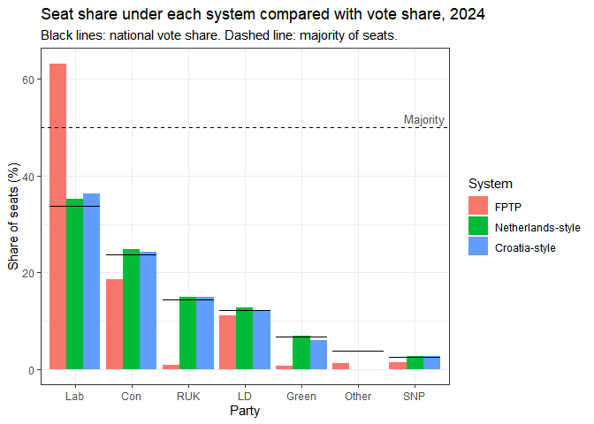
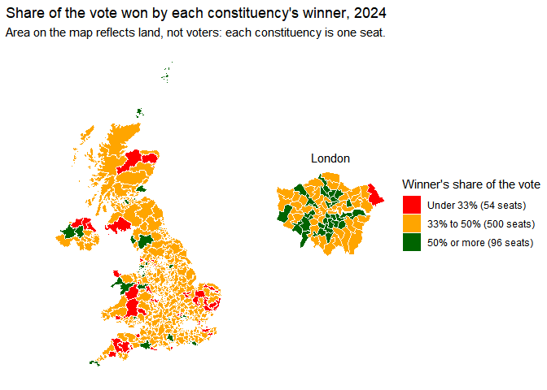
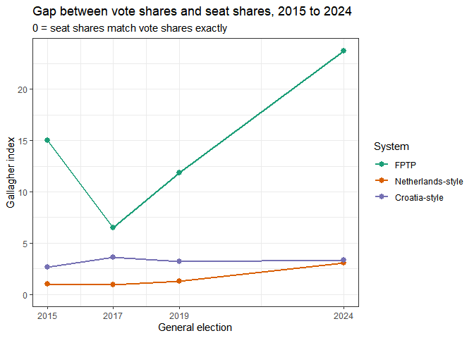
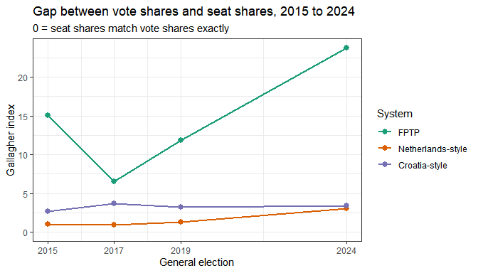

What if the UK used a different voting system?
================
Oliver Porter
2026-10-13

## Introduction

This analysis applies three seat allocation rules to the constituency
results of UK General Elections: first past the post (FPTP), a
Netherlands-style single national list, and a Croatia-style regional
list with a 5% threshold. Sections 1 to 4 look at the 2024 election in
detail, and section 5 repeats the comparison for 2015, 2017 and 2019. It
is a mechanical recount of the votes as they were cast. Voters, parties
and candidates would be likely to behave differently under another
system, so the results show what the same votes would produce under each
rule, not what would have happened in an election held under it.

## Setup

``` r
library(tidyverse)
library(sf)
library(patchwork)
source("Functions.R")   # load_election, get_parties, dhondt, fptp,
                        # netherlands_style, croatia_style, compare_systems, gallagher
```

## 1. Data preparation

``` r
ge2024 = load_election(2024)
named = get_parties(ge2024)
total_seats = nrow(ge2024)
```

`load_election()` reads the House of Commons Library results file, drops
the two columns that are empty for every constituency (County name and
Declaration time), and checks that there are 650 constituencies with no
duplicates and that party votes add up to valid votes in every one. The
party columns are found automatically as every numeric column that is
not a total such as Electorate or Valid votes. Because the vote totals
must match, a column wrongly treated as a party would stop the code.

“All other candidates” combines several independents and small parties,
so it is not treated as a party in any system. Under FPTP the column “Of
which other winner” is used instead, which holds the votes of a single
winning candidate outside the named parties. Under the two list systems
only the named parties can win seats, but the thresholds are measured
against all valid votes. `fptp()` also checks its winner against the
official result in every constituency and stops if any differ.

## 2. Seats under each system

``` r
comparison = compare_systems(ge2024)

seat_tab = comparison %>%
  select(party, vote_share, system, seats) %>%
  pivot_wider(names_from = system, values_from = seats) %>%
  arrange(desc(vote_share))

knitr::kable(seat_tab, digits = 1,
             col.names = c("Party", "Vote share (%)", levels(comparison$system)),
             caption = "Table 1: Seats won by each party under the three systems, 2024.")
```

| Party | Vote share (%) | FPTP | Netherlands-style | Croatia-style |
|:------|---------------:|-----:|------------------:|--------------:|
| Lab   |           33.7 |  411 |               229 |           236 |
| Con   |           23.7 |  121 |               161 |           158 |
| RUK   |           14.3 |    5 |                97 |            97 |
| LD    |           12.2 |   72 |                83 |            79 |
| Green |            6.7 |    4 |                45 |            39 |
| Other |            3.8 |    8 |                 0 |             0 |
| SNP   |            2.5 |    9 |                17 |            18 |
| SF    |            0.7 |    7 |                 4 |             6 |
| PC    |            0.7 |    4 |                 4 |             5 |
| DUP   |            0.6 |    5 |                 4 |             5 |
| APNI  |            0.4 |    1 |                 2 |             3 |
| UUP   |            0.3 |    1 |                 2 |             2 |
| SDLP  |            0.3 |    2 |                 2 |             2 |

Table 1: Seats won by each party under the three systems, 2024.

``` r
lab = comparison %>% filter(party == "Lab") %>% arrange(system)
majority_line = floor(total_seats / 2) + 1
list_gap = max(abs(seat_tab[["Netherlands-style"]] - seat_tab[["Croatia-style"]]))
```

Under FPTP the largest party, Labour, wins 411 seats on 33.7% of the
vote, above the 326 needed for a majority. Under the Netherlands-style
and Croatia-style systems the same votes give 229 and 236 seats, so no
party reaches a majority under either. The two list systems give similar
results to each other for every party, with the largest difference
between them being 7 seats.

``` r
comparison %>%
  filter(vote_share > 2) %>%
  ggplot(aes(x = reorder(party, -vote_share), y = seat_share, fill = system)) +
  geom_col(position = "dodge") +
  geom_errorbar(aes(ymin = vote_share, ymax = vote_share), width = 0.9) +
  geom_hline(yintercept = 50, linetype = "dashed") +
<<<<<<< HEAD
  annotate("text", x = Inf, y = 50, label = "Majority", hjust = 1.1, vjust = -0.5,
           size = 3.5, colour = "grey30") +
=======
>>>>>>> 8f35f49c92444be01ae28328c8c5fb8ae623c5ba
  theme_bw() +
  labs(x = "Party", y = "Share of seats (%)", fill = "System",
       title = "Seat share under each system compared with vote share, 2024",
       subtitle = "Black lines: national vote share. Dashed line: majority of seats.")
```

<<<<<<< HEAD
=======
<!-- -->

``` r
comparison %>%
  filter(vote_share > 2) %>%
  ggplot(aes(x = reorder(party, -vote_share), y = seat_share, fill = system)) +
  geom_col(position = position_dodge(width = 0.9), width = 0.85) +
  geom_errorbar(aes(ymin = vote_share, ymax = vote_share, linetype = "National vote share"),
                width = 0.95, linewidth = 0.8) +
  geom_hline(yintercept = 50, linetype = "dashed", colour = "grey40") +
  annotate("text", x = Inf, y = 50, label = "Majority", hjust = 1.1, vjust = -0.5,
           size = 3.5, colour = "grey30") +
  scale_fill_manual(values = c("#D55E00", "#0072B2", "#56B4E9")) +
  scale_linetype_manual(values = c("National vote share" = "solid")) +
  guides(fill = guide_legend(order = 1)) +
  theme_bw() +
  labs(x = "Party", y = "Share of seats (%)", fill = "System", linetype = NULL,
       title = "Seat share under each system compared with vote share, 2024")
```

>>>>>>> 8f35f49c92444be01ae28328c8c5fb8ae623c5ba
<!-- -->

Under the two list systems each party’s seat share is close to its
national vote share. Under FPTP the two differ more, in both directions:
parties whose votes are concentrated in particular constituencies win a
larger share of seats than votes, and parties whose votes are spread
evenly across many constituencies win a smaller share. This follows from
how the rule works, since FPTP counts constituency winners and the list
systems count total votes.

## 3. Measuring the difference between votes and seats

To summarise the gap between vote shares and seat shares in a single
number, we use the Gallagher index,
$G = \sqrt{\frac{1}{2}\sum_i (v_i - s_i)^2}$, where $v_i$ and $s_i$ are
each party’s percentage of votes and seats. A value of 0 means seat
shares match vote shares exactly.

``` r
gallagher_tab = gallagher(comparison)

knitr::kable(gallagher_tab, digits = 2,
             col.names = c("System", "Gallagher index", "Largest party",
                           "Seats", "Majority", "Parties winning seats"),
             caption = "Table 2: Gallagher index and summary of each system, 2024.")
```

| System | Gallagher index | Largest party | Seats | Majority | Parties winning seats |
|:---|---:|:---|---:|:---|---:|
| FPTP | 23.75 | Lab | 411 | TRUE | 13 |
| Netherlands-style | 3.04 | Lab | 229 | FALSE | 12 |
| Croatia-style | 3.36 | Lab | 236 | FALSE | 12 |

Table 2: Gallagher index and summary of each system, 2024.

``` r
g = setNames(gallagher_tab$gallagher, gallagher_tab$system)
other_share = comparison %>% filter(party == "Other", system == "FPTP") %>% pull(vote_share)
```

The Gallagher index is 23.7 under FPTP, 3 under the Netherlands-style
system and 3.4 under the Croatia-style system. The Croatia-style figure
is slightly higher than the Netherlands-style one because seats are
shared out within each of the twelve regions, so rounding happens twelve
times, and the 5% threshold applies in each region. Neither list system
reaches 0, partly because votes for other candidates (3.8% nationally)
cannot win seats in this analysis.

The index measures one property only. Electoral systems are also
compared on other criteria that it does not capture, such as the link
between an MP and a single constituency, how often one party can govern
alone, how coalitions are formed, and how simple the ballot is. This
analysis does not weigh those criteria against each other.

<<<<<<< HEAD
## 4. How much of the vote did winners need?

Under FPTP a candidate needs more votes than any other candidate, not a
majority. This map shows the share of the vote won by the winner in each
constituency in 2024.

``` r
bands = c("Under 33%", "33% to 50%", "50% or more")

results = ge2024 %>%
  mutate(win_share = 100 * do.call(pmax, pick(all_of(c(named, "Of which other winner")))) /
           `Valid votes`)

constituency_map = read_sf("data/boundaries/PCON_JULY_2024_UK_BUC.shp") %>%
  left_join(results, by = c("PCON24CD" = "ONS ID")) %>%
  mutate(band = cut(win_share, c(0, 100 / 3, 50, Inf), labels = bands, right = FALSE))

stopifnot(nrow(constituency_map) == total_seats, !anyNA(constituency_map$band))

fill_scale = scale_fill_manual(values = c("red", "orange", "darkgreen"), limits = bands,
                               labels = paste0(bands, " (", table(constituency_map$band), " seats)"),
                               name = "Winner's share\nof the vote")

uk_map = ggplot(filter(constituency_map, `Region name` != "London"), aes(fill = band)) +
  geom_sf(colour = "white", linewidth = 0.03) + fill_scale + theme_void()

box = st_bbox(filter(constituency_map, `Region name` == "London"))

london_map = ggplot(filter(constituency_map, `Region name` == "London"), aes(fill = band)) +
  geom_sf(colour = "white", linewidth = 0.15, show.legend = FALSE) + fill_scale + theme_void() +
  annotate("text", x = (box$xmin + box$xmax) / 2, y = box$ymax, label = "London", vjust = -1) +
  coord_sf(clip = "off")

uk_map + london_map +
  plot_layout(widths = c(2.2, 1), guides = "collect") +
  plot_annotation(title = "Share of the vote won by each constituency's winner, 2024",
                  subtitle = "Area on the map reflects land, not voters: each constituency is one seat.")
```

<!-- -->

``` r
lowest = slice_min(st_drop_geometry(constituency_map), win_share)
```

Only 96 of the 650 MPs elected in 2024 won at least half the votes in
their constituency, and 54 won with less than a third. The lowest
winning share was 26.7% in South West Norfolk. In most constituencies,
more voters chose someone other than the winner than chose the winner.
=======
## 4. Map of FPTP winners, 2024

``` r
party_cols = c(Con = "#0087DC", Lab = "#E4003B", LD = "#FAA61A", RUK = "#12B6CF",
               Green = "#02A95B", SNP = "#FDF38E", PC = "#005B54", DUP = "#D46A4C",
               SF = "#326760", SDLP = "#2AA82C", UUP = "#48A5EE", APNI = "#F6CB2F",
               Other = "grey60")

winners_map = read_sf("data/boundaries/PCON_JULY_2024_UK_BUC.shp") %>%
  left_join(ge2024, by = c("PCON24CD" = "ONS ID")) %>%
  mutate(winner = if_else(`First party` %in% names(party_cols), `First party`, "Other"))

seats = sort(table(winners_map$winner), decreasing = TRUE)

uk_map = ggplot(filter(winners_map, `Region name` != "London"), aes(fill = winner)) +
  geom_sf(colour = "white", linewidth = 0.03) +
  scale_fill_manual(values = party_cols, limits = names(seats),
                    labels = paste0(names(seats), " (", seats, ")")) +
  theme_void() +
  labs(fill = "Winner (seats)")

london = filter(winners_map, `Region name` == "London")
box = st_bbox(london)

london_map = ggplot(london, aes(fill = winner)) +
  geom_sf(colour = "white", linewidth = 0.15, show.legend = FALSE) +
  scale_fill_manual(values = party_cols) +
  annotate("text", x = (box$xmin + box$xmax) / 2, y = box$ymax, label = "London",
           vjust = -2) +
  coord_sf(clip = "off") +
  theme_void()

uk_map + london_map +
  plot_layout(widths = c(2.2, 1), guides = "collect") +
  plot_annotation(title = "Winning party by constituency under FPTP, 2024",
                  subtitle = "Area on the map reflects land, not voters: each constituency is one seat.")
```

<!-- -->
>>>>>>> 8f35f49c92444be01ae28328c8c5fb8ae623c5ba

## 5. Four elections, three systems

To see whether the 2024 pattern is typical, the same three rules are
applied to the 2015, 2017 and 2019 results. Each file goes through the
same loading checks, and each year keeps its own party columns, so
parties that stood in different years are treated as separate parties
rather than merged. The 2015 to 2019 elections used the constituency
boundaries in place before 2024, so they are compared on seat totals
rather than mapped.

``` r
years = c(2015, 2017, 2019, 2024)

all_results = NULL
<<<<<<< HEAD
for (y in years){
  data = load_election(y)
=======
for (y in years)
  {
  data = load_election(y)

>>>>>>> 8f35f49c92444be01ae28328c8c5fb8ae623c5ba
  all_results = rbind(all_results, compare_systems(data) %>% mutate(year = y))
  }

by_year = gallagher(all_results)
```

``` r
ggplot(by_year, aes(x = year, y = gallagher, colour = system)) +
  geom_line(linewidth = 1) +
  geom_point(size = 2.5) +
  scale_x_continuous(breaks = years) +
  scale_colour_brewer(palette = "Dark2") +
  expand_limits(y = 0) +
  theme_bw() +
  labs(x = "General election", y = "Gallagher index", colour = "System",
       title = "Gap between vote shares and seat shares, 2015 to 2024",
       subtitle = "0 = seat shares match vote shares exactly")
```

<<<<<<< HEAD
<!-- -->
=======
<!-- -->
>>>>>>> 8f35f49c92444be01ae28328c8c5fb8ae623c5ba

``` r
by_year %>%
  mutate(result = paste0(largest_party, " ", largest_seats,
                         if_else(majority, " (majority)", ""))) %>%
  select(year, system, result) %>%
  pivot_wider(names_from = system, values_from = result) %>%
  knitr::kable(col.names = c("Election", levels(by_year$system)),
               caption = "Table 3: Largest party and its seats under each system.")
```

| Election | FPTP               | Netherlands-style | Croatia-style |
|---------:|:-------------------|:------------------|:--------------|
|     2015 | Con 330 (majority) | Con 244           | Con 247       |
|     2017 | Con 317            | Con 280           | Con 291       |
|     2019 | Con 365 (majority) | Con 290           | Con 297       |
|     2024 | Lab 411 (majority) | Lab 229           | Lab 236       |

Table 3: Largest party and its seats under each system.

``` r
g_range = by_year %>%
  group_by(system) %>%
  summarise(low = min(gallagher), high = max(gallagher))
fptp_majorities = sum(by_year$majority[by_year$system == "FPTP"])
list_majorities = sum(by_year$majority[by_year$system != "FPTP"])
```

Across the four elections the Gallagher index under FPTP ranges from 6.5
to 23.7, compared with 0.9 to 3 under the Netherlands-style system and
2.7 to 3.6 under the Croatia-style system. FPTP gives a single-party
majority in 3 of the 4 elections, while the two list systems give one in
0 of 8 cases.

## Summary

Applied to the 2024 votes, FPTP gives a single-party majority, while
both list systems give no party a majority and seat shares close to
national vote shares. The two list systems differ from each other only
slightly, with regional allocation and the 5% threshold accounting for
the gap. Across 2015 to 2024 the Gallagher index under FPTP ranges from
6.5 to 23.7, against at most 3.6 under either list system. These figures
describe the mechanical effect of each rule on one set of votes per
election; they do not predict how an election under a different system
would have gone.
